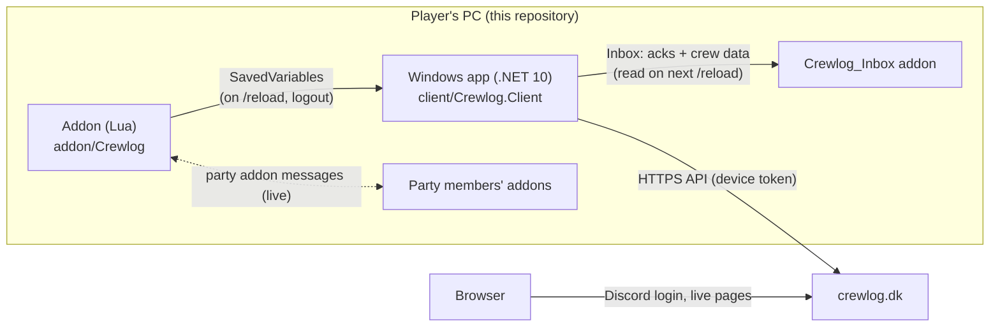

# Crewlog

[](https://github.com/niogtres/wow_crewlog/actions/workflows/test.yml)
[](https://github.com/niogtres/wow_crewlog/releases/latest)

Group questing made easy in **World of Warcraft: Forever**. Crewlog shows what everyone in your crew is on right now,
which quests you share, and what you can pick up together next.

Live at **https://crewlog.dk** · players start from the download button there.
What changed per release: [CHANGELOG.md](CHANGELOG.md) and [Releases](https://github.com/niogtres/wow_crewlog/releases).

This repository holds what runs on your PC: the **addon** and the **Windows app**, plus the data shapes they exchange
with the website. The website and its server at crewlog.dk are not part of it.

## What it does

- **Your current quests, always in view:** each toon's quest log with objective progress, on the website and live.
- **Journals:** share with friends. Everyone sees what each other's toons are on, who can join a quest and who has
  done it, plus quests you could pick up together. Invite by link or key, optional password.
- **In game:** a compass by the minimap syncs with one click; `/cl` shows your journal crew, `/cl next` what to pick
  up next, quest tooltips show who else is on a quest or has done it, a journal's suggested route can be shown on the
  world map, and party members who run Crewlog see each other's progress live, within seconds. Member colours and
  markers over heads are opt-in.
- **Accounts:** Discord login only. Pick a name and picture, add a bio and links, delete toons or your whole account.

Crewlog only uses the game's official addon interface: no automation, no memory reading, no changes to the game.

## How it fits together



- **Addon** (`addon/Crewlog`): records quest events, harvests quest givers, syncs live with the party
  (`Live.lua`), shows the crew window and the journal route on the world map. Data leaves the game only through
  SavedVariables, which WoW writes on `/reload` and logout.
- **Windows app** (`client/`): a tray app. It watches the SavedVariables file, uploads changes, writes the
  `Crewlog_Inbox` addon (acks so the addon can prune, plus the journal crew's quests and routes), installs and
  updates the addon, and updates itself (Velopack installer, delta updates).

## Repository

| Path | What |
|---|---|
| `addon/Crewlog`, `addon/Crewlog_Inbox` | The addon and its data-only inbox. `addon/Crewlog_Probe` is an API probe. |
| `addon/tests` | Lua tests with a fake WoW client (`harness.lua`); they also write `fixtures/generated/*.lua` for the .NET parser tests. |
| `client/Crewlog.Client` | Tray app (WinForms), installer hooks, status window. |
| `client/Crewlog.Client.Core` | SavedVariables parser, sync engine, inbox writer, updater, migrations from the old name. |
| `client/Crewlog.Client.Cli` | `crewlog` command-line tool for debugging (dump, locate, watch, link, push). |
| `client/Crewlog.Client.Tests` | xUnit tests for the app. |
| `shared/Crewlog.Contracts` | The JSON shapes the app and the website exchange. |
| `tools/` | Addon packing and the brand assets (installer splash, tray icon). |
| `docs/` | `forever-api.md` (what the Forever client's addon API offers), brand assets. |

## Building and testing

You need the **.NET 10 SDK** (pinned in `global.json`). For the addon tests, Lua 5.1 or Docker.

```powershell
dotnet build Crewlog.slnx
dotnet test Crewlog.slnx

# addon tests (no Lua install needed)
docker run --rm -v "${PWD}:/src" -w /src nickblah/lua:5.1 sh -c "lua addon/tests/collector_test.lua && lua addon/tests/live_test.lua && lua addon/tests/next_test.lua"
```

Releases (installer and addon zip) are on the [Releases](https://github.com/niogtres/wow_crewlog/releases) page and
at https://crewlog.dk. Installed apps check for updates 20 seconds after start and every 30 minutes, and install them
by themselves.

## Credits and license

GPL-3.0, see [LICENSE](LICENSE). Created and maintained by Thomas Kraft.

- Quest, NPC and object data: [QuestieDB](https://github.com/Questie/QuestieDB) (GPL-3.0).
- Quest links and tooltips: [Wowhead](https://www.wowhead.com/forever).
- Fonts: Bricolage Grotesque, Figtree and JetBrains Mono (SIL Open Font License).
- Installer and updates: [Velopack](https://velopack.io).

Crewlog is a fan project and is not affiliated with or endorsed by Blizzard Entertainment. World of Warcraft is a
trademark of Blizzard Entertainment, Inc.
